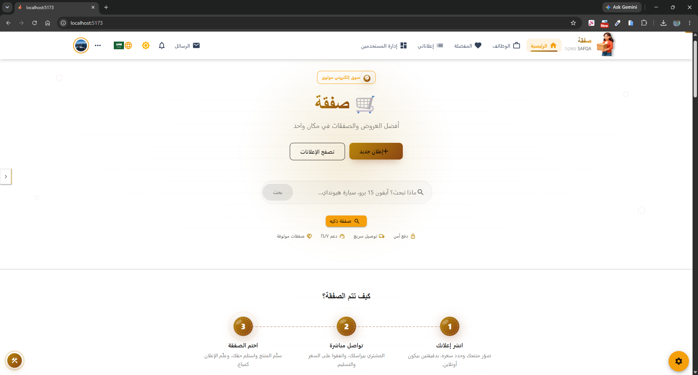
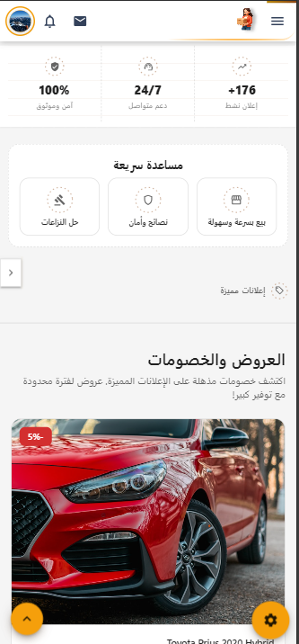
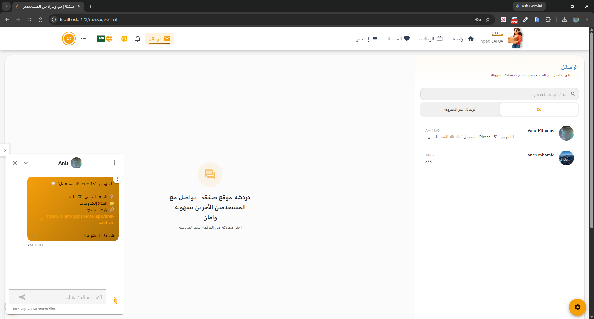
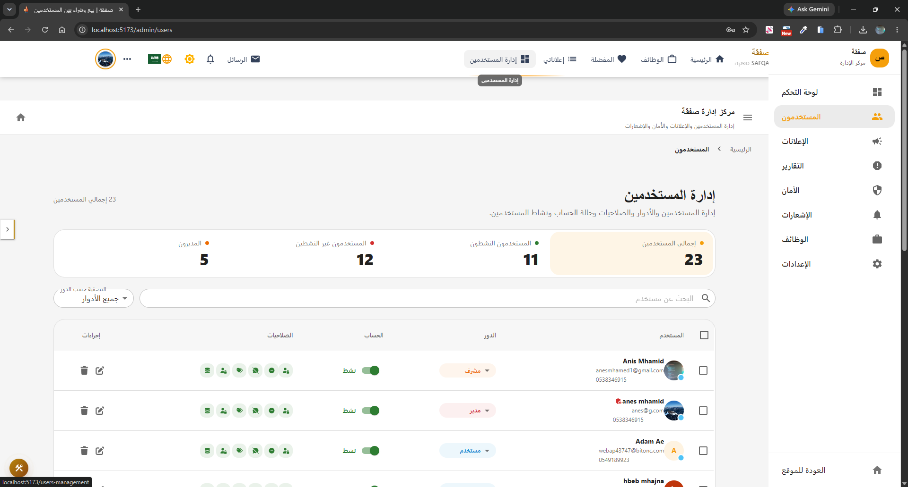
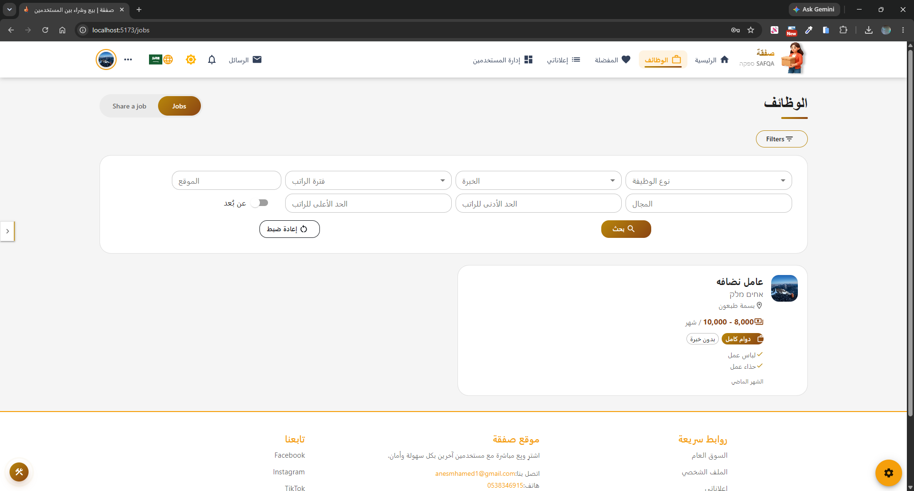
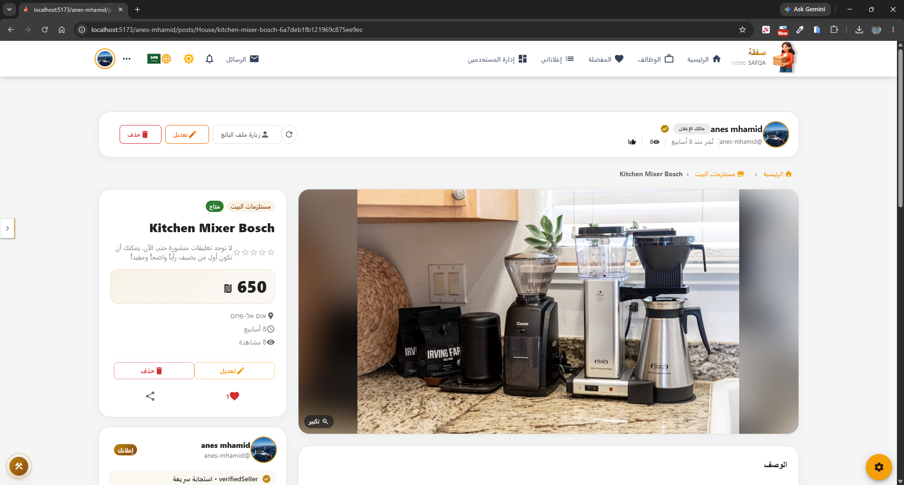

# Safqa — Marketplace and Job Platform

<div align="center">


**A modern Arabic-first marketplace that combines buying, selling, communication, and job opportunities in one experience.**

[Live demo](https://client-qqq1.vercel.app) · [Frontend](https://github.com/Anismhamid/client) · [Backend](https://github.com/Anismhamid/server)


</div>

**Safqa** is a consumer-to-consumer marketplace frontend for browsing listings, publishing advertisements, connecting buyers with sellers, managing accounts, and discovering job opportunities.

The interface supports Arabic, Hebrew, and English, including right-to-left layouts. This repository contains the frontend only; listings, authentication, administration, and security-sensitive operations depend on the separately deployed backend.

---

## What the Platform Includes

### Marketplace

- Discover new and used products from individual sellers.
- Browse listings by category and subcategory.
- Search listings and save search preferences.
- View listing details, specifications, seller profiles, and related products.
- Create, edit, delete, and manage advertisements.
- Save favorite listings.
- Browse featured advertisements, discounts, offers, and promoted content.
- Use paginated listings and lazy-loaded marketplace sections.
- Report inappropriate listings or users where supported by the backend.

### Accounts and Profiles

- Register and log in.
- Recover and reset passwords.
- Authenticate with Google on the web.
- Use native social login in the Android application.
- View and edit personal profile information.
- Publish a shareable public customer profile.
- Manage blocked users and account privacy.
- Request account deletion through a dedicated interface.
- View reputation, ratings, activity, and profile completion information.

### Messaging and Notifications

- Communicate through private and floating chat interfaces.
- Receive real-time updates with Socket.IO.
- Manage conversations and blocked contacts.
- Receive browser and native Android notifications.
- Send notifications from the administration center.
- View sent notifications and notification history.
- Investigate message activity and review audit logs when authorized.

### Jobs

- Browse job listings and job categories.
- Open full job details.
- Create and edit job advertisements.
- View job seeker information where supported.
- Review and manage jobs from the admin center.

### Blog

- Browse articles and open individual blog posts.
- Create and edit articles with a Markdown-oriented editor.
- Manage published content.
- Provide article pages that are suitable for SEO.

### Admin Center

- Display dashboard statistics and charts.
- Manage users, roles, statuses, and permissions.
- Moderate listings and review reports.
- Review and manage job listings.
- Manage blocked users.
- Browse message audit logs and investigate conversations.
- Send notifications and review notification history.
- Configure administrative settings.

---

## User Experience

- Arabic is the default language.
- English and Hebrew resources are loaded when selected.
- RTL layout support for Arabic and Hebrew.
- Persistent light and dark themes.
- Responsive layouts for desktop, tablet, and mobile.
- Lazy loading for routes and heavy components.
- Smooth transitions and animations with Framer Motion.
- SEO metadata and structured data where implemented.
- Open Graph data for supported sharing and listing pages.

---

## Technology Stack

| Area | Technology |
|---|---|
| UI framework | React 19 |
| Language | TypeScript 5 |
| Build tool | Vite 6 |
| Routing | React Router DOM 7 |
| UI components | MUI 7, MUI Joy, Emotion, Bootstrap |
| Forms | Formik |
| Validation | Yup |
| HTTP client | Axios |
| Real-time communication | Socket.IO Client 4 |
| Internationalization | i18next, react-i18next |
| Charts | Recharts |
| Animation | Framer Motion |
| Notifications | React Toastify, SweetAlert2 |
| Dates | Day.js |
| Images | Cloudinary, html2canvas, react-zoom-pan-pinch |
| Content | marked, DOMPurify |
| Authentication | Google OAuth, jwt-decode |
| Android runtime | Capacitor 8 |
| Bundle analysis | rollup-plugin-visualizer |

---

## Requirements

- Node.js compatible with Vite 6
- npm
- A running Safqa backend API
- A Google OAuth client ID for Google sign-in
- Android Studio, JDK, and Android SDK for Android builds

---

## Getting Started

```bash
git clone https://github.com/Anismhamid/client.git
cd client
npm install
```

Create `.env` in the project root:

```env
VITE_API_URL=http://localhost:8209/api
VITE_API_SOCKET_URL=http://localhost:8209
VITE_API_GOOGLE_API=your_google_client_id
VITE_API_VIREFY_TOKEN=https://your-api-domain/api/users/verify-email/
VITE_API_CLOUDINARY_UPLOADIMAGE_URL=https://api.cloudinary.com/v1_1/your-cloud-name/image/upload
VITE_API_CLOUDINARY_UPLOADIMAGE_NAME=your_upload_preset
VITE_SITE_URL=http://localhost:5173
```

Start the frontend:

```bash
npm run dev
```

Vite normally serves the application at `http://localhost:5173`. The actual port may change if that port is unavailable.

### Environment Variables

| Variable | Purpose |
|---|---|
| `VITE_API_URL` | Base URL for backend API requests |
| `VITE_API_SOCKET_URL` | Socket.IO server URL |
| `VITE_API_GOOGLE_API` | Google OAuth client ID |
| `VITE_API_VIREFY_TOKEN` | Email verification URL or prefix used by the frontend |
| `VITE_API_CLOUDINARY_UPLOADIMAGE_URL` | Cloudinary image upload endpoint |
| `VITE_API_CLOUDINARY_UPLOADIMAGE_NAME` | Cloudinary upload preset or configuration name |
| `VITE_SITE_URL` | Public frontend URL used for sharing |

All `VITE_` variables are included in the browser bundle. Never store secrets, signing keys, passwords, or private credentials in these variables.

---

## Available Scripts

| Command | Description |
|---|---|
| `npm run dev` | Start the Vite development server |
| `npm run build` | Create a production build in `dist` |
| `npm run preview` | Preview the production build locally |
| `npm run start` | Build the project and run Vite preview |
| `npm run lint` | Run ESLint |
| `npm run version:auto` | Update project version information |
| `npm run android:sync` | Synchronize the web build with Capacitor Android |
| `npm run android:open` | Open the Android project in Android Studio |
| `npm run release` | Run automatic versioning and the Android release build |

---

## Project Structure

```text
client/
├── android/                 # Capacitor Android project
├── public/                  # Static assets and screenshots
├── src/
│   ├── App.tsx              # Application providers and global UI
│   ├── main.tsx             # Application entry point
│   ├── atoms/               # Shared UI elements and actions
│   ├── components/          # Pages and feature components
│   ├── context/             # React context providers
│   ├── hooks/               # User, listing, and notification hooks
│   ├── interfaces/          # TypeScript interfaces
│   ├── locales/             # Arabic, Hebrew, and English resources
│   ├── routes/              # Routes and route guards
│   ├── services/            # API, image, and notification services
│   └── socket/              # Socket.IO setup
├── utils/                   # SEO and structured-data utilities
├── scripts/                 # Versioning and build scripts
├── vite.config.ts
├── capacitor.config.ts
└── package.json
```

---

## Main Routes

| Route | Description |
|---|---|
| `/` | Marketplace home page |
| `/login`, `/register` | Sign in and create an account |
| `/password-recover`, `/reset-password/:token` | Password recovery |
| `/search`, `/saved-searches` | Search and saved searches |
| `/category/:category/:subCategory?` | Category browsing |
| `/posts/:postId` | Listing details |
| `/my-ads-dashboard` | User advertisement dashboard |
| `/favorites` | Favorite listings |
| `/profile`, `/profile/:id` | Personal profiles |
| `/users/customer/:slug` | Public customer profile |
| `/messages`, `/chat`, `/messages/chat` | Messaging interfaces |
| `/jobs`, `/jobs/:id` | Job listings and details |
| `/jobs/create`, `/jobs/:id/edit` | Create and edit jobs |
| `/blog`, `/blog/:slug` | Blog and articles |
| `/blog/new`, `/blog/edit/:id`, `/blog/manage` | Blog creation and management |
| `/payment/success` | Payment success page |
| `/help/selling`, `/help/safety`, `/help/disputes` | Selling, safety, and dispute guidance |

### Admin Center

The following pages are wrapped by `AdminGuard` and require an `Admin` or `Moderator` role in the frontend user state:

| Route | Description |
|---|---|
| `/admin` | Admin dashboard |
| `/admin/users` | User and role management |
| `/admin/posts` | Listing moderation |
| `/admin/jobs` | Job management |
| `/admin/jobs/:jobId` | Administrative job details |
| `/admin/reports` | Report management |
| `/admin/security/blocked` | Blocked users |
| `/admin/security/audit-logs` | Message audit logs |
| `/admin/security/investigation` | Message investigation |
| `/admin/notifications/send` | Send notifications |
| `/admin/notifications/sent` | Sent notifications |
| `/admin/settings` | Administrative settings |

Frontend route guards improve navigation and user experience, but they do not replace server-side authorization.

---

## Android Application

The repository includes a Capacitor Android project under `android/` with application ID `com.safqa.c2c`.

Synchronize the web app with Android:

```bash
npm run android:sync
```

Open Android Studio:

```bash
npm run android:open
```

On Linux or macOS, build an Android App Bundle with:

```bash
npm run build
npx cap sync android
cd android
./gradlew :app:bundleRelease
```

The existing `android:build` script uses `gradlew.bat`, so it is intended for Windows. The generated bundle is normally written under:

```text
android/app/build/outputs/bundle/release/
```

Before publishing:

1. Review the application ID, version name, and version code.
2. Configure production signing.
3. Review permissions and push notification setup.
4. Confirm API, Socket.IO, Google, and update URLs for the production environment.

---

## Production Build

```bash
npm run build
```

The production files are generated in `dist/`.

Vite also creates bundle analysis reports:

- `stats/stats.html`
- `stats/stats.json`

The Vite configuration separates React and MUI dependencies through `manualChunks` when possible.

---

## Security and Privacy

- Authentication, authorization, and input validation must be enforced by the backend.
- Never place private keys or secrets in `VITE_` variables.
- Sanitize rendered user content appropriately.
- Configure CORS, cookies, sessions, and CSRF protection for the production environment.
- Restrict administrative, reporting, and message operations by server-side permissions.
- Review Content Security Policy and deployment headers before launch.
- Treat frontend route guards and hidden controls only as UI protections.

---

## Screenshots

<p align="center">
  
  
</p>

<p align="center">
  
  
</p>

<p align="center">
  
  
</p>

---

## Contributing

1. Create a feature or fix branch.
2. Make a focused change that follows existing project patterns.
3. Run `npm run lint`.
4. Run `npm run build`.
5. Open a pull request with the reason, implementation, and testing performed.

```bash
git checkout -b feature/improvement
npm run lint
npm run build
git add .
git commit -m "Improve: short description"
git push origin feature/improvement
```

---

## License

This project is licensed under the [MIT License](Licencse.md).

Copyright © 2025 Anis
